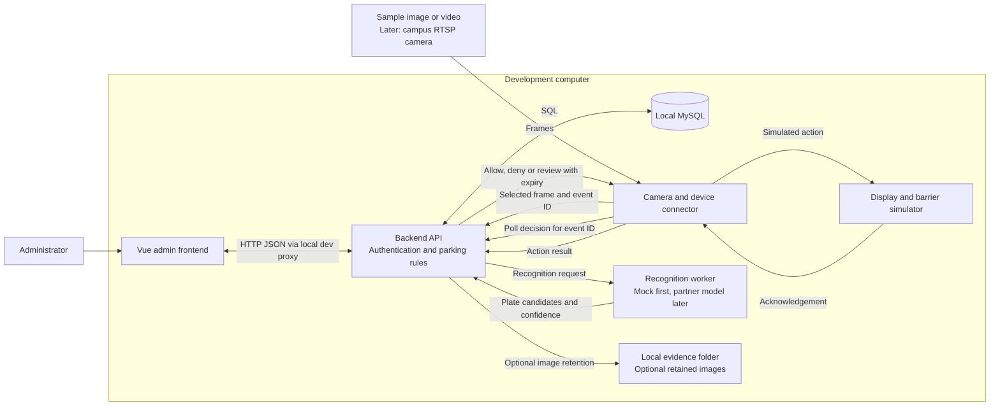
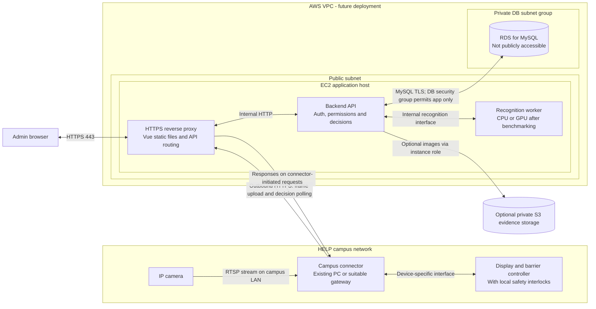
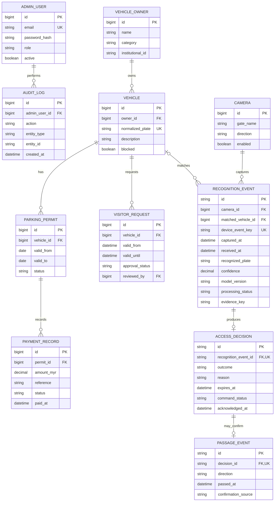

# Architecture diagrams

Editable Mermaid diagrams for the proposed local-first HELP University parking system. See README.md in this folder for assumptions and build order.

## 01-local-development



## 02-aws-deployment



## 03-access-sequence

```mermaid
sequenceDiagram
  participant C as Campus connector
  participant A as Backend API
  participant R as Recognition worker
  participant D as MySQL
  participant B as Barrier / display adapter
  C->>A: Submit frame (device identity, unique event ID, capture time)
  A->>D: Create or retrieve event using unique device/event key
  A-->>C: Accepted or existing event reference
  A->>R: Recognise selected frame
  R-->>A: Candidates, confidence, model version, inference time
  A->>D: Save recognition; check vehicle, permit and visitor approval
  Note over A,D: Apply server time in Asia/Kuala_Lumpur; blocked vehicles override permits
  alt No reliable match, missing permission or processing failure
    A->>D: Record DENY or REVIEW with reason
  else Eligible vehicle and sufficiently confident recognition
    A->>D: Record ALLOW with decision ID and short validity period
  end
  C->>A: Poll event decision over outbound HTTPS
  A-->>C: Decision, reason, decision ID and expiry
  alt Decision is fresh, ALLOW and not already executed
    C->>B: Show result and request opening
    Note over C,B: Hardware controller enforces obstacle and safety interlocks
    B-->>C: Acknowledge command or report fault
    C->>A: Acknowledge action with decision ID
    A->>D: Record command outcome
    opt Passage sensor or reliable crossing confirmation available
      C->>A: Report confirmed vehicle passage and direction
      A->>D: Create entry or exit record
    end
  else DENY, REVIEW, expired decision or connection timeout
    Note over C,B: Do not auto-open; use agreed manual fallback
  end
```

## 04-database-erd



